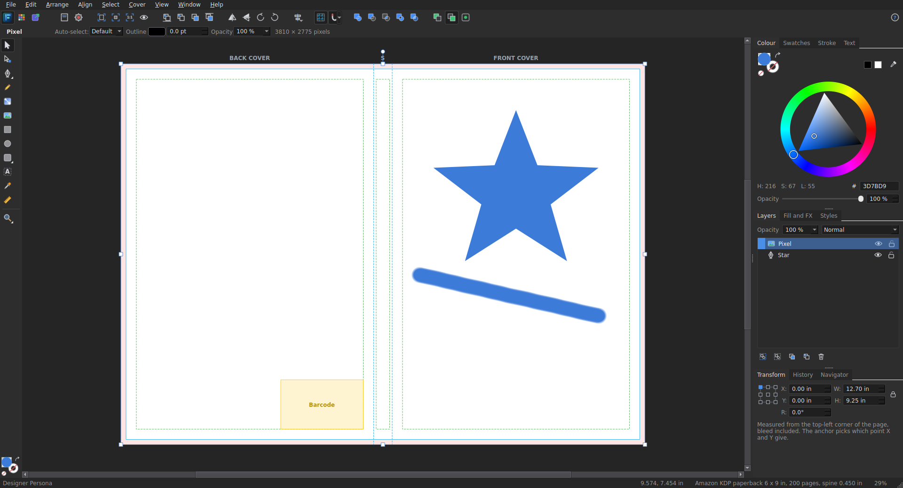

# Folio

Folio is a free graphic design app for Linux, made for book covers.
It works like the well-known professional design apps: tools on the left,
panels on the right, and your page in the middle.

## What it does

- **Paperback and hardcover covers.** Pick a book size, page count and paper.
  Folio works out the spine width and the full wrap size, with bleed (or the
  hardcover wrap and hinges). It shows the back cover, spine, front cover,
  safe margins and the barcode area.
- **A start window** with New, Open, Recent and Templates. The New page has a
  searchable list of ready-made sizes (hearts mark favourites, and you can save
  your own presets), a picture of the page, and Layout, Colour, Margins and
  Bleed tabs with a Document Summary.
- **Ready-made sizes.** Amazon KDP, IngramSpark and Lulu covers (126 book
  sizes), pocket, UK and European, square, landscape and comic sizes; book
  pages; eBook, audiobook and podcast covers; paper sizes; cards, bookmarks
  and posters; social media.
- **Panels in three stacks of tabs:** Colour (a hue ring with a triangle, colour
  code, opacity and an eyedropper), Swatches, Stroke (style, width, ends,
  corners, and outlines inside or outside the edge) and Text; Layers, Fill and
  FX, and Styles; Transform (with an anchor point), History and Navigator.
- **Three personas, like the pro apps.** *Designer* for layout; *Pixel* for
  painting and retouching (paint, erase, blur, dodge and burn brushes, flood
  fill, rectangle, ellipse, row, column, freehand and flood selections; painting
  on a photo works on a copy, so the original file is never changed); and
  *Export* for slices: named areas (whole cover, front cover, spine, or any area
  you draw) each saved as PDF, PNG or JPEG in one go.
- **Brushes panel** (Pixel persona): 11 categories (Acrylics, Dry Media,
  Engraving, Gouaches, Inks, Markers, Oils, Patterns, Pencils, Pens,
  Watercolours), each brush shown as a picture of its stroke, with search.
  Flat chisel tips, speckled chalk and charcoal, hatching, and stamps such as
  stars and hearts. Folio remembers the brush you chose.
- **Rulers, guides and a grid.** Drag guides out of the rulers; things snap to
  guides and to the grid.
- **Blend modes** (Multiply, Screen, Overlay and more) in the Layers panel. A PDF
  with blending is made as a 300 dpi picture, since PDF cannot blend.
- **Toolbars like the pro apps.** A top bar of grouped buttons (arrange, flip
  and rotate, align, snapping, combining shapes, where new objects go) with a
  second bar that changes with the tool and the selection; tools down the left
  with fly-outs, and the fill and outline circles at the bottom.
- **Drawing.** Rectangles, rounded rectangles, ellipses, triangles, diamonds,
  stars, polygons, arrows and hearts; lines; a Pen tool for curves; a Pencil for
  freehand. The Node tool edits the points of a curve.
- **Combining shapes.** Add, Subtract, Intersect, Combine and Divide, plus
  Convert to Curves (turn a title into shapes you can edit) and Separate Curves.
- **Gradient, Colour picker and Measure tools.** Drag a gradient across a shape,
  pick up any colour on the page, measure a distance.
- **Insert behind, on top or inside.** New shapes and pictures can go inside the
  selected shape, like a photo inside a circle.
- **91 font families built in**, free to use on books you sell: classic book
  serifs, bold modern sans, script and handwriting, and display styles for
  horror, fantasy, sci-fi and children's books. See [fonts/README.md](fonts/README.md).
  The Text panel groups them, shows each name in its own lettering, and
  *More fonts* installs fonts you download (even a whole .zip).
- **Text.** Type straight onto the page. Any installed font, bold, italic,
  all capitals, letter and line spacing, alignment, text that wraps,
  letter outlines and shadows. *Add Spine Text* places turned text
  on the spine for you.
- **Photos.** Place or paste pictures, or drag them in from the file manager.
  *Paste Inside* puts a photo inside a shape or inside the letters of a title.
  *Fill* covers the front cover (and its bleed) in one click. Folio warns you
  when a photo is too low in resolution to print well.
- **Style.** Solid colours, linear and radial gradients, see-through colours,
  outlines, rounded corners, opacity and soft drop shadows. *Paste Style* copies
  one object's look onto others, and saved *Styles* put a look on in one click.
- **Layout.** Snapping to guides and other objects, Align and Space Evenly
  (to the selection, the page, the front cover, the spine or the back cover),
  groups, layers you can hide, lock, rename and drag to restack.
- **Import.** PDF pages (as sharp pictures, or as a new document the same
  size), Word documents (as text you can edit, or as page pictures through
  LibreOffice), and the preview picture saved inside Affinity files.
- **Print** on your own printer, with Print Setup and Print Preview.
- **Export.** Print-ready PDF at the exact cover size, with trim and bleed
  boxes and text turned into shapes, so printers never complain about fonts.
  PNG and JPEG for ebook covers and adverts (whole cover, front only, and so on).
- **Files.** New from Clipboard, New from Last Preset, Export as Template, and
  Save As Package (a folder with the design plus copies of its fonts and pictures,
  ready to hand to someone else).
- **Safe.** Unlimited undo with a History panel, and an automatic rescue copy
  while you work.

## The website

`website/` holds the project's web page: plain HTML, CSS and JavaScript with no
libraries, so it can be put on GitHub Pages or any web host as it is. Open
`website/index.html` to see it. When Folio is on GitHub, change `live` to
`true` in `website/app.js` and the GitHub buttons point at the project.

## Running it

Folio needs Python 3 and PyQt5. On Linux Mint and Ubuntu:

    sudo apt install python3-pyqt5

Start it from this folder:

    python3 folio.py

To add it to your applications menu, and open `.folio` files with a
double-click:

    bash install.sh

## Keyboard shortcuts

| Key | Does |
| --- | --- |
| V | Move tool |
| A | Edit points of a curve |
| P | Pen |
| L | Line |
| M | Rectangle |
| E | Ellipse |
| T | Text |
| H, or hold Space | Hand (move around) |
| Z | Zoom |
| W | Preview the trimmed cover |
| Ctrl+0 / Ctrl+1 | Fit page / actual pixels |
| Ctrl+J | Duplicate |
| Ctrl+G / Ctrl+Shift+G | Group / ungroup |
| Ctrl+Shift+I | Place an image |
| Ctrl+Shift+E | Export |
| N | Pencil |
| G | Gradient fill |
| U | Rounded rectangle |
| I | Colour picker |
| Ctrl+Enter | Convert to curves |
| Ctrl+Shift+V | Paste style |
| Ctrl+Alt+V | Paste inside |
| Ctrl+Alt+Shift+N | New from clipboard |
| Ctrl+, | Settings |
| Ctrl+R / Ctrl+' | Rulers / grid |
| Tab (on the page) | Hide or show the panels |
| B, E, O (Pixel persona) | Paint, erase, dodge brushes |
| S, K (Export persona) | Slice, slice selection |
| F1 | All shortcuts |

## The .folio file

A `.folio` file is a zip archive holding `document.json` (the page and every
object), the original image files in `assets/`, and a small `thumbnail.png`.

## Checking it works

    QT_QPA_PLATFORM=offscreen python3 -m tests.test_smoke
    QT_QPA_PLATFORM=offscreen python3 -m tests.test_more
    QT_QPA_PLATFORM=offscreen python3 -m tests.test_import
    QT_QPA_PLATFORM=offscreen python3 -m tests.test_affinity
    QT_QPA_PLATFORM=offscreen python3 -m tests.test_tools
    QT_QPA_PLATFORM=offscreen python3 -m tests.test_personas

Each one ends with ALL GOOD when everything works.

Three slower audits try to break it: `tests.audit_everything` clicks every menu
command and tool in every persona, `tests.audit_random` does hundreds of random
actions with undo, redo, save, open and export, and `tests.audit_bad_input`
feeds it damaged files and extreme sizes. Each prints `problems: 0` when clean.

## License

Made by 4ThePeople Media. Copyright (C) 2026 Aaron McCreery.

Folio is free software under the GNU General Public License, version 3.
See [LICENSE](LICENSE). The bundled fonts keep their own licences
(SIL Open Font License or Apache 2.0), stored next to each font.

## Support

This project is free and open source. If it is useful to you, you can support my work with a donation:

